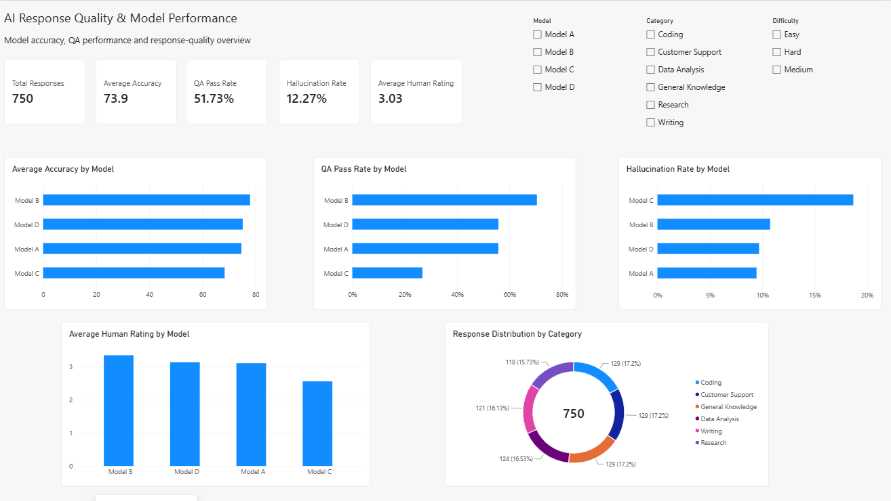
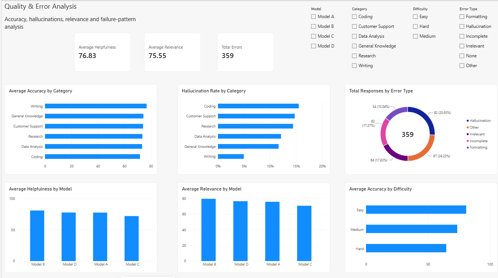
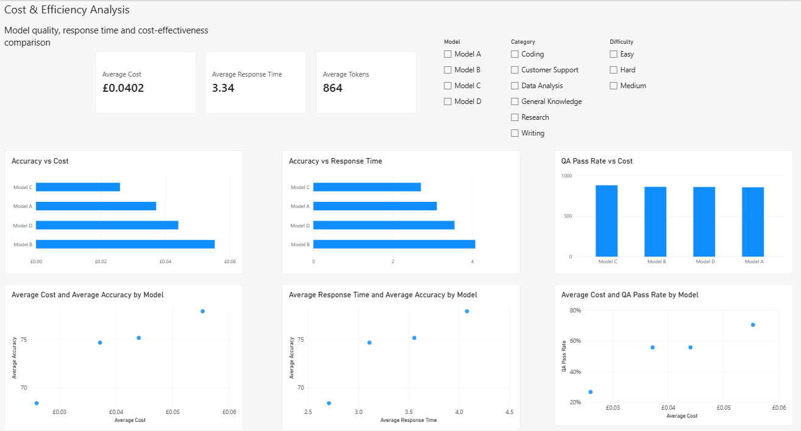

# AI Response Quality & Model Performance Analysis

## Project Overview
This portfolio project evaluates a **simulated AI response dataset** to compare model quality, hallucination risk, QA performance, error patterns, cost and efficiency.

The project uses Excel, MySQL and Power BI to turn AI evaluation data into business insights and recommendations.

## Tools
- Excel
- MySQL / SQL
- Power BI
- Power Query
- DAX

## Dataset
750 simulated AI responses across four fictional models: Model A, Model B, Model C and Model D.

Evaluation fields include accuracy, helpfulness, relevance, hallucination, response time, cost, tokens used, human rating, QA result, category, difficulty and error type.

## Business Questions
1. Which model performs best overall?
2. Which model has the lowest hallucination rate?
3. Which model has the strongest QA pass rate?
4. How does difficulty affect performance?
5. Which categories perform best and worst?
6. What error types occur most often?
7. How do cost and response time compare with quality?
8. Which model offers the best balance of quality and cost?

## Dashboard

### 1. AI Performance Overview
KPIs:
- Total Responses: **750**
- Average Accuracy: **73.9**
- QA Pass Rate: **51.73%**
- Hallucination Rate: **12.27%**
- Average Human Rating: **3.03**



### 2. Quality & Error Analysis
KPIs:
- Average Helpfulness: **76.83**
- Average Relevance: **75.55**
- Total Errors: **359**



### 3. Cost & Efficiency Analysis
KPIs:
- Average Cost: **£0.0402**
- Average Response Time: **3.34 seconds**
- Average Tokens: **864**



## Key Findings
- Model B demonstrates the strongest overall quality and QA performance.
- Model C performs weakest overall and has the highest hallucination rate.
- Hard prompts perform worse than Easy and Medium prompts.
- Hallucination is the largest observed failure category.
- Model B is more expensive and slower, highlighting a quality/cost trade-off.
- Model C is cheaper and faster but produces weaker quality results.

## Skills Demonstrated
- AI response evaluation
- AI quality analysis
- Hallucination analysis
- QA metrics
- SQL / MySQL
- Power BI
- Power Query
- DAX
- KPI reporting
- Data visualisation
- Cost/performance analysis
- Error-pattern analysis
- Business recommendations

## Repository Structure
```text
AI_Response_Quality_Portfolio_Package/
├── README.md
├── Excel/
│   └── AI_Response_Quality_Analysis.xlsx
├── SQL/
│   └── AI_Response_Analysis.sql
├── PowerBI/
│   └── AI_Response_Quality_Dashboard.pbix
├── Screenshots/
│   ├── 01_AI_Performance_Overview.png
│   ├── 02_Quality_and_Error_Analysis.png
│   └── 03_Cost_and_Efficiency_Analysis.png
└── Documentation/
    ├── DAX_Measures.md
    └── Findings_and_Recommendations.md
```

> The dataset is simulated and intended for portfolio demonstration purposes.
